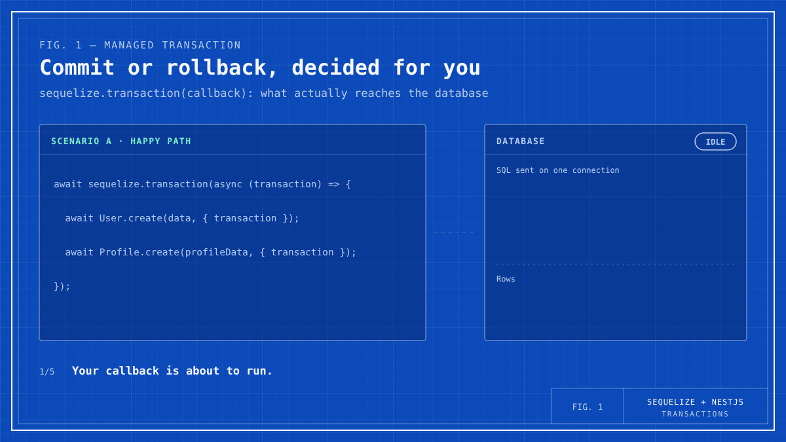
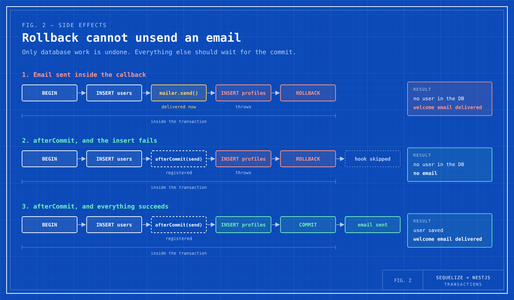
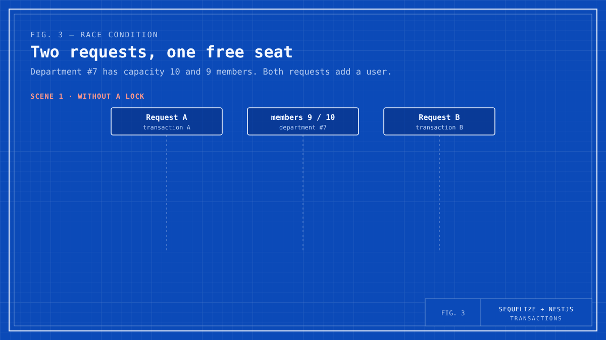
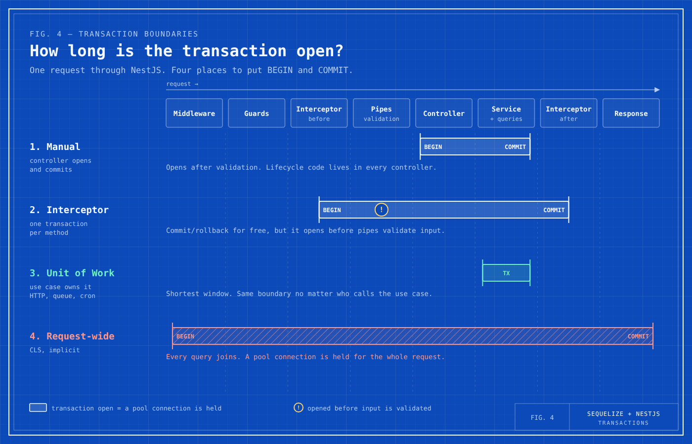
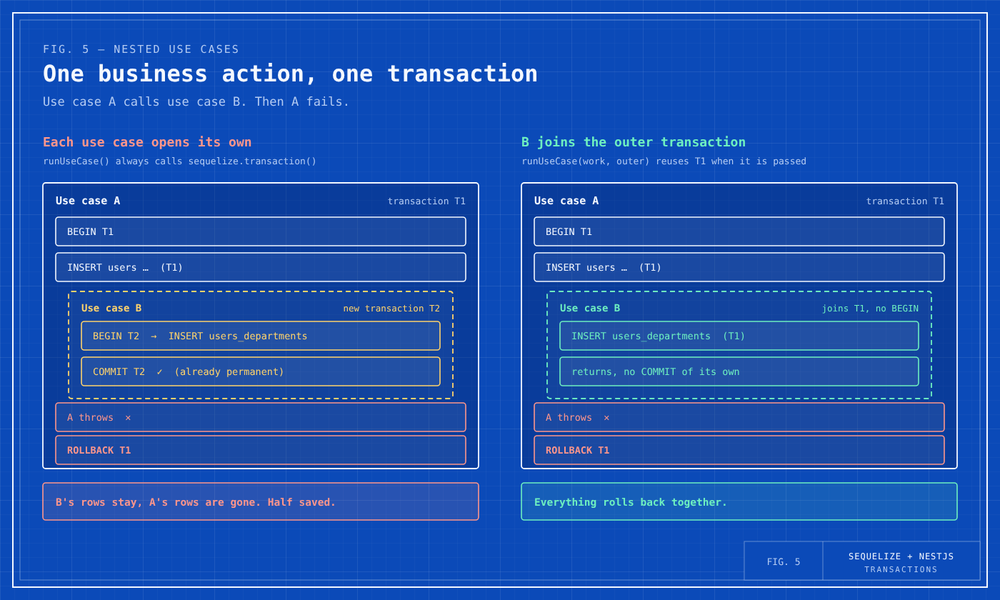
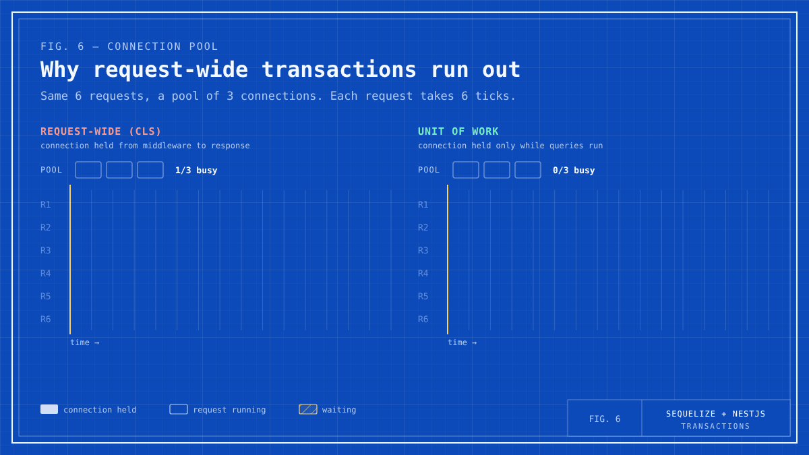

# 3 ways to use transactions with Sequelize + NestJS

Example project for the Medium article **"3 ways to use transactions with Sequelize + NestJS"**.

One small domain (users, departments, and the link between them) is built three times, once for each pattern:

| Module | Pattern | Who owns the transaction |
| --- | --- | --- |
| [`manual-transaction`](src/modules/manual-transaction) | Manual transaction in the controller | The controller opens, commits, and rolls back |
| [`interceptor-transaction`](src/modules/interceptor-transaction) | Interceptor + `@DbTransaction()` | The interceptor, for one controller method |
| [`unit-of-work`](src/modules/unit-of-work) | Service-level Unit of Work | The use case (service), no matter who calls it |

Stack: NestJS 11, Sequelize 6 (`sequelize-typescript`), PostgreSQL, Zod.

## The ideas in pictures

### 1. A managed transaction commits or rolls back for you



`sequelize.transaction(callback)` sends `BEGIN`, runs your queries on one connection, and then sends `COMMIT` if the callback resolves or `ROLLBACK` if it throws. Every query still needs `{ transaction }`.

### 2. Rollback cannot unsend an email



Only database work is rolled back. Put emails, queue messages, and HTTP calls in `transaction.afterCommit(...)`, which runs only after a successful commit.

### 3. A transaction alone does not stop race conditions



With the default isolation level, two requests can both read a stale value. Start with constraints, then use row locks (`lock: transaction.LOCK.UPDATE`), and use `SERIALIZABLE` with retries only if you need it.

### 4. Where the transaction boundary lives



The shorter the window, the less time a connection and its locks are held. The Unit of Work keeps the window around the queries only.

### 5. Nested use cases should share one transaction



If use case A calls use case B and both open their own transaction, B can commit while A rolls back. Let `runUseCase` reuse an outer transaction when one is passed in.

### 6. Why request-wide transactions run out of connections



A request-wide transaction (CLS) holds a pool connection from middleware to response. Under load, new requests wait for a connection even though most of that time is not spent in the database.

## Running locally

```bash
npm install
cp .env.example .env   # adjust DB_* values for your Postgres
npm run start:dev
```

Swagger UI is available at `http://localhost:<SERVER_PORT>/docs`.

## Recommendations

- Default to a service-level Unit of Work.
- Interceptor-scoped transactions are a good fit for small HTTP-only services.
- Use manual controller transactions only for special cases.
- Avoid request-wide transactions unless you can enforce strict rules.
- Keep transactions short, explicit, owned by the business layer, and database-only.
